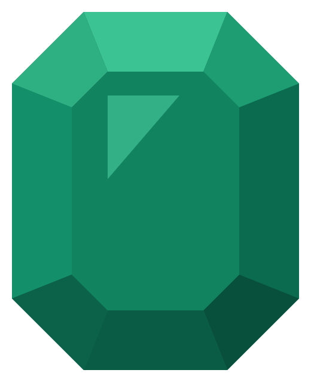
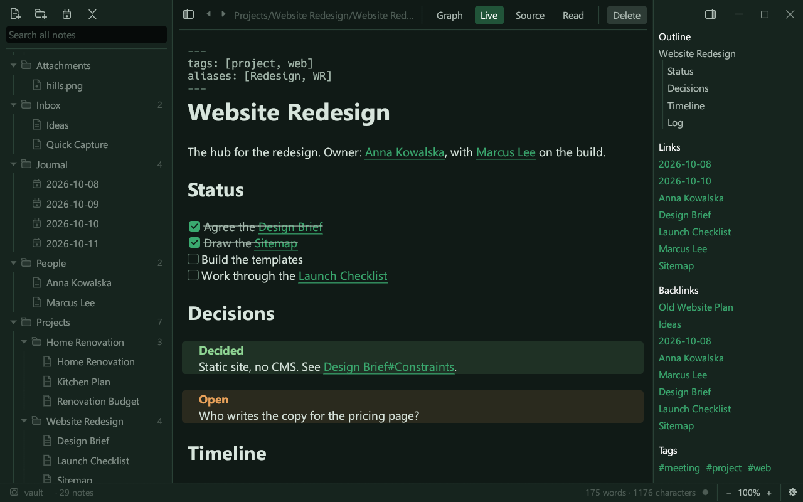
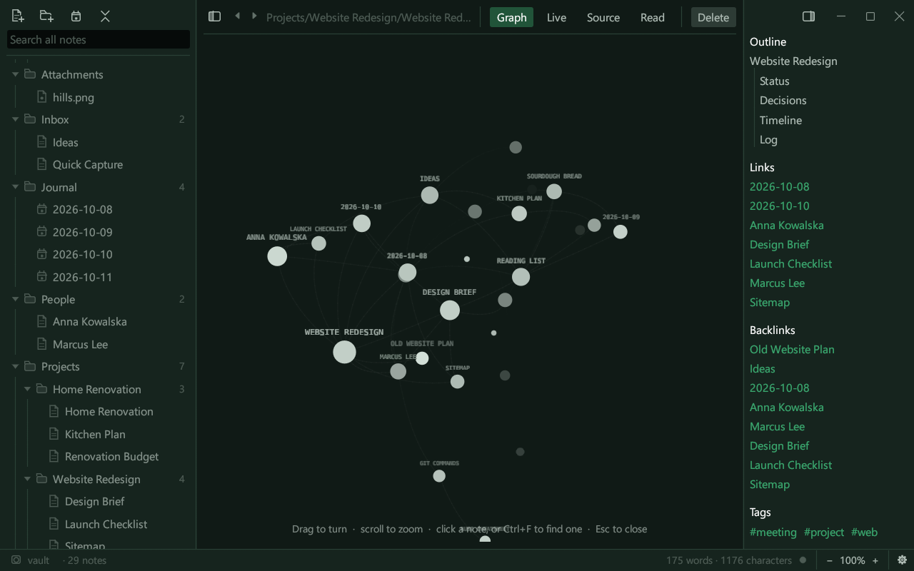
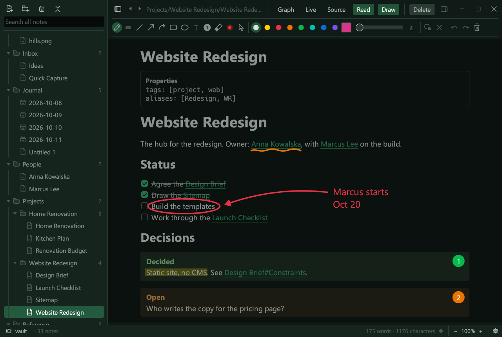
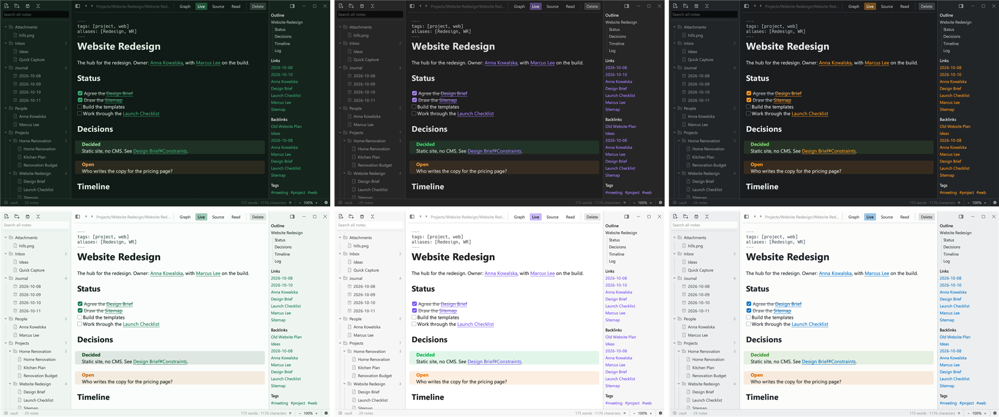

<p align="center">
  
</p>

<h1 align="center">Malachite</h1>

<p align="center">
  A fast, local notes app for a vault of Markdown files, written in Rust.
</p>

<p align="center">
  <a href="https://github.com/FastHaze/malachite/actions/workflows/ci.yml"></a>
  <a href="https://github.com/FastHaze/malachite/releases/latest"></a>
  <a href="LICENSE"></a>
</p>

<p align="center">
  
</p>

---

Malachite works on a **vault**: an ordinary folder of `.md` files, linked to one
another with `[[wikilinks]]`. There is no database and no account. Your notes
stay plain files that any editor can open, and a vault you already keep in
another Markdown app opens as it is, links, tags, properties and all.

The project is highly inspired by [Obsidian](https://obsidian.md): it follows
the same idea of a vault, the same Markdown extensions, and the same command
names and shortcuts, so it should feel familiar from the first minute.
Malachite is an independent open-source project, not affiliated with or
endorsed by Obsidian or Dynalist Inc.

## Features

- **Three views of a note.** Live Preview formats the note as you type and
  shows the Markdown only around the cursor. Source mode shows all of it.
  Reading view shows the finished note. Ctrl+E switches between them.
- **Links between notes.** `[[Note]]`, `[[Note#Heading]]`, `[[Note#^block]]`,
  `[[Note|shown text]]` and aliases. Renaming a note updates the links to it.
  The side panel lists a note's outline, links, backlinks and tags.
- **Embeds and footnotes.** `![[picture.png]]` and `![[Another note]]` are shown
  in place. Footnotes are numbered and linked.
- **The Markdown you expect.** Headings, lists, tasks, tables, quotes,
  callouts, code blocks highlighted in over twenty languages, `#tags`,
  YAML properties, `==highlights==` in any colour, `%%comments%%`.
- **Folding** of headings and lists.
- **A 3D graph** of the vault (Ctrl+G). Click a note to see it with only the
  notes it is linked with, gathered round it. Ctrl+F there finds notes by
  name.
- **Search** across the vault (Ctrl+Shift+F) with `tag:`, `path:`, `file:`, `task:`,
  `line:` and `section:` operators, plus find and replace in a note.
- **Command palette** (Ctrl+P) and **quick switcher** (Ctrl+O).
- **Daily notes and templates**, with `{{title}}`, `{{date}}` and `{{time}}`.
- **Themes**: Gem, Obsidian, Aperture and Cyberpunk, each with a light and a dark scheme.
  Every colour can be changed in a plain settings file.
- **Light on the machine.** A frame that would draw what the window already
  shows is not drawn, so moving the mouse over a note costs almost nothing.
  The graph slows to a stop when you leave it alone.
- **A command-line companion**, `malachite-cli`, to list, search, create and
  rename notes from a terminal.

The sample vault in [`vault/`](vault) has a tour of everything Malachite can show,
in [`vault/Overview.md`](vault/Overview.md).

Some things are left out on purpose: math, Mermaid diagrams, pictures from the
web, and embedded PDF, audio and video.

## Screenshots

The graph of the sample vault:



Drawing over a note in Reading view, with the tools in a row above it:



Three of the themes, Gem, Obsidian and Aperture, each in its dark and light scheme:



## Install

Download the build for your system from the
[latest release](https://github.com/FastHaze/malachite/releases/latest):

| System | File | How to start it |
|---|---|---|
| Windows 10 / 11 (x64) | `malachite-<version>-windows-x64.zip` | Unzip and run `malachite.exe`. |
| macOS 11+ (Apple silicon and Intel) | `malachite-<version>-macos-universal.zip` | Unzip and move `Malachite.app` to Applications. |
| Linux (x64) | `malachite-<version>-linux-x64.tar.gz` | Unpack and run `./malachite`. |

Each download also has `malachite-cli` and the sample vault.

Malachite starts in the vault it had open last time. On its very first run,
started from its own folder on Windows or Linux, it opens the sample `vault`
beside it; otherwise, and on macOS, it makes an empty vault called `Malachite`
in your Documents folder. Click the vault's name in the status bar to open
another, such as the sample vault or one you already have.

**macOS:** the app is not signed by Apple yet, so the first time, right-click
`Malachite.app` and choose **Open**. Or run
`xattr -dr com.apple.quarantine /Applications/Malachite.app` once.

**Linux:** you need X11 or Wayland with OpenGL, which any desktop has. There
is no folder picker on Linux yet: type the vault's path in the vault switcher.

### Build from source

You need Rust 1.83 or newer ([rustup.rs](https://rustup.rs)).

```bash
git clone https://github.com/FastHaze/malachite
cd malachite
cargo run --release --bin malachite             # the app, on ./vault
cargo run --release --bin malachite -- ~/Notes  # the app, on another vault
cargo run --release --bin malachite-cli -- list # the CLI
```

On Linux the build itself needs no extra packages.

## Shortcuts

Ctrl is ⌘ Cmd on macOS.

| Keys | Does |
|---|---|
| Ctrl+P | Command palette: every command, by name |
| Ctrl+O | Quick switcher: open a note by name |
| Ctrl+N | New note |
| Ctrl+E | Switch between editing and reading |
| Ctrl+F / Ctrl+H | Find / find and replace in the note |
| Ctrl+Shift+F | Search the whole vault |
| Ctrl+G | Graph view |
| Ctrl+Alt+← / → | Back / forward |
| Ctrl+B / Ctrl+I | Bold / italic |
| Ctrl+K | Insert a link |
| Ctrl+L | Tick or untick a task |
| Ctrl+/ | Comment |
| Ctrl+, | Settings |
| Ctrl+= / Ctrl+− / Ctrl+0 | Zoom in / out / reset |

## Settings

Malachite keeps three small files:

- `malachite.conf`, in your settings folder (`%APPDATA%\malachite` on Windows,
  `~/.config/malachite` elsewhere), for how the app looks: theme, scheme, text
  size, line width, colours.
- `.malachite/malachite.conf` inside each vault, for that vault's files: where
  new notes go, the templates and daily notes folders, what deleting does,
  whether renames update links.
- `settings.txt`, beside the first, where the app remembers how it was left.

The settings dialog (Ctrl+,) and a text editor are two ways of changing the
same files. Each setting is in the file with a comment saying what it does.

## Status

Malachite is young, at **0.x**, and in daily use on Windows, where it is most
tried. The macOS and Linux builds are made and tested by the release workflow
but have had less use. Please [open an issue](https://github.com/FastHaze/malachite/issues)
for anything that does not work.

Coming next: an Editor page in the settings, a choice of fonts, tabs,
bookmarks, and snapshots of notes to recover from.

## Versions

Malachite follows [semantic versioning](https://semver.org). Before 1.0, a new
minor version (0.2, 0.3, …) can change behaviour or the settings files, and a
patch version (0.2.1) only fixes things. Every release is a tag `vX.Y.Z` with
builds attached, and [CHANGELOG.md](CHANGELOG.md) says what changed.

## Contributing

Issues and pull requests are welcome. Before a pull request, run:

```bash
cargo test     # the library, and the whole interface without a window
```

[CLAUDE.md](CLAUDE.md) explains how the code is organised and why. Malachite
builds on a slightly changed copy of eframe, in [`vendor/`](vendor), which
[`vendor/README.md`](vendor/README.md) describes.

## Licence

Malachite is under the [MIT licence](LICENSE).

It is built on [egui and eframe](https://github.com/emilk/egui) (MIT or Apache
2.0). The copy in `vendor/eframe` keeps its own licence. The programs carry
egui's built-in fonts: Hack (MIT), Ubuntu (Ubuntu Font Licence) and Noto Emoji
(SIL Open Font Licence). Note text is shown in a font already on your system.

"Obsidian" is a trademark of Dynalist Inc., used here only to say where the
inspiration comes from.
